# خطة المشروع — منصة إدارة المدارس والتعليم عن بُعد (PLAN.md)

> الحالة: **مسودة بانتظار الموافقة** — لن تبدأ المرحلة 0 قبل اعتمادها.
> المراجع: `SPEC.md` (المواصفات) و`PROMPT.md` (التعليمات). كل قرار غير وارد في المواصفات مسجل في `DECISIONS.md` مع رقمه (D-xx).

---

## 1. خيارات تعدد المستأجرين (مطلوبة في SPEC §9.10)

| المعيار | A) قاعدة مشتركة + `school_id` | B) Schema لكل مدرسة | C) قاعدة بيانات لكل مدرسة |
|---|---|---|---|
| العمل على cPanel المشترك | ✅ ممتاز | ❌ MySQL: Schema = Database، ومعظم الاستضافات تحدد عدد القواعد | ❌ نفس المشكلة + إنشاء قاعدة يحتاج صلاحيات |
| تشغيل Migrations | ✅ مرة واحدة | ❌ تكرار لكل مدرسة، وخطر عدم تطابق الإصدارات | ❌ نفس B |
| ولي أمر بأبناء في مدارس مختلفة | ✅ استعلام واحد | ❌ يحتاج ربط عبر قواعد | ❌ نفس B |
| معرف الطالب الثابت وانتقاله بين المدارس | ✅ طبيعي | ⚠️ معقد | ⚠️ معقد |
| قوة العزل | ⚠️ يعتمد على انضباط الكود (يُعالج بالتصميم أدناه) | ✅ أقوى | ✅ الأقوى |
| نسخ احتياطي/استعادة مدرسة واحدة | ⚠️ يحتاج تصدير مفلتر | ✅ سهل | ✅ سهل |
| تكلفة التشغيل | ✅ الأقل | متوسطة | ❌ الأعلى |

**التوصية: الخيار A** (قاعدة واحدة + `school_id`) لأن بيئة النشر المستهدفة هي cPanel/VPS دون root، ولأن المواصفات تتطلب ولي أمر عابرًا للمدارس ومعرّفًا ثابتًا للطالب. نعوّض ضعف العزل بثلاث طبقات:
1. `TenantContext` يُملأ من الجلسة فقط؛ لا يقرأ أبدًا من GET/POST.
2. `BaseRepository` يضيف `school_id = :tenant` تلقائيًا، ويرمي استثناءً إن نُفذ استعلام على جدول مُعلَّم كـ tenant-scoped دون سياق.
3. اختبارات PHPUnit إلزامية لكل Repository تحاول الوصول لسجل مدرسة أخرى (يجب أن يفشل).

> **أحتاج موافقتك الصريحة على الخيار A.**

---

## 2. المعمارية

```
المتصفح (HTML/CSS/JS + SW/IndexedDB)
   │  fetch() JSON + CSRF
   ▼
public/index.php  (Front Controller)
   ▼
Router ─► Middleware stack: SecurityHeaders → Session → Csrf → RateLimit → Auth → Tenant → Permission
   ▼
Controller (رقيق: تحقق مدخلات + استدعاء Service + عرض/JSON)
   ▼
Service (قواعد العمل + فحص الصلاحية + كتابة audit_logs + transaction)
   ▼
Repository (PDO prepared فقط + school_id تلقائي)
   ▼
MySQL 8 (InnoDB, utf8mb4_unicode_ci)
```

**المبادئ**
- Controllers لا تحتوي SQL. Services لا تعرف HTTP. Repositories لا تحتوي قواعد عمل.
- الصلاحية تُفحص مرتين: Middleware (على المسار) و Service (على العملية)، وللمعلم/ولي الأمر فحص **نطاق السجل** (Row-level scope: شعبه المسندة / أبناؤه المرتبطون).
- كل مخرج في القوالب عبر `e()`؛ كل النصوص عبر ملفات اللغة `lang/ar.php` (ومفاتيح جاهزة لـ `en.php`).
- التكاملات (SMS, WhatsApp, Email, Zoom/Meet/Jitsi, الدفع) خلف Interfaces: `SmsGateway`, `WhatsAppGateway`, `MailGateway`, `MeetingProvider`, `PaymentChannel`. مزود افتراضي = تسجيل في ملف log.
- الإشعارات عبر **طابور** (جدول `notification_queue` + سكربت Cron) حتى لا تعطل الطلب عند ضعف الشبكة.
- الوحدات الموسعة (المستوى 2–4) تُفعَّل لكل مدرسة عبر `school_modules` المرتبط بخطة الاشتراك، ولا تعتمد عليها النواة.

**البنية الداخلية للمجلدات:** كما في PROMPT.md، مع إضافة: `lang/`، `bin/` (cron وseed-demo وbackup)، `public/sw.js` و`public/manifest.webmanifest`.

---

## 3. مخطط الكيانات والعلاقات (ERD)

> يغطي النواة والعلاقات الرئيسية بين كل المجالات. الجداول الكاملة (≈110 جدول) تُكتب في `schema.sql` بالمرحلة 0 وفق القوائم في §3.2.

### 3.1 المخطط (Mermaid)

```mermaid
erDiagram
  SCHOOLS ||--o{ SCHOOL_SUBSCRIPTIONS : has
  SUBSCRIPTION_PLANS ||--o{ SCHOOL_SUBSCRIPTIONS : defines
  SCHOOLS ||--o{ USERS : employs
  SCHOOLS ||--o{ ROLES : customizes
  ROLES ||--o{ ROLE_PERMISSIONS : grants
  PERMISSIONS ||--o{ ROLE_PERMISSIONS : in
  USERS ||--o{ USER_ROLES : assigned
  ROLES ||--o{ USER_ROLES : in

  SCHOOLS ||--o{ ACADEMIC_YEARS : runs
  ACADEMIC_YEARS ||--o{ TERMS : splits
  SCHOOLS ||--o{ STAGES : offers
  STAGES ||--o{ GRADE_LEVELS : contains
  GRADE_LEVELS ||--o{ SECTIONS : divides
  ACADEMIC_YEARS ||--o{ SECTIONS : scopes
  SUBJECTS ||--o{ SECTION_SUBJECTS : taught_in
  SECTIONS ||--o{ SECTION_SUBJECTS : has
  SECTION_SUBJECTS ||--o{ TEACHER_ASSIGNMENTS : assigned
  STAFF ||--o{ TEACHER_ASSIGNMENTS : teaches
  SECTION_SUBJECTS ||--o{ TIMETABLE_SLOTS : scheduled
  ROOMS ||--o{ TIMETABLE_SLOTS : hosts

  STUDENT_IDENTITIES ||--o{ STUDENTS : "has school record"
  SCHOOLS ||--o{ STUDENTS : owns
  STUDENTS ||--o{ STUDENT_ENROLLMENTS : enrolled
  SECTIONS ||--o{ STUDENT_ENROLLMENTS : contains
  ACADEMIC_YEARS ||--o{ STUDENT_ENROLLMENTS : in
  STUDENTS ||--o{ STUDENT_STATUS_HISTORY : tracks
  STUDENTS ||--o{ DISCIPLINE_RECORDS : has
  STUDENTS ||--o{ STUDENT_GUARDIANS : linked
  GUARDIANS ||--o{ STUDENT_GUARDIANS : linked
  USERS ||--o| GUARDIANS : "login for"
  USERS ||--o| STAFF : "login for"
  USERS ||--o| STUDENTS : "login for"

  TIMETABLE_SLOTS ||--o{ ATTENDANCE_SESSIONS : generates
  ATTENDANCE_SESSIONS ||--o{ ATTENDANCE_RECORDS : has
  STUDENT_ENROLLMENTS ||--o{ ATTENDANCE_RECORDS : marked

  GRADING_SCHEMES ||--o{ ASSESSMENT_TYPES : weights
  GRADING_SCHEMES ||--o{ GRADE_SCALES : letters
  SECTION_SUBJECTS ||--o{ ASSESSMENTS : evaluated
  ASSESSMENT_TYPES ||--o{ ASSESSMENTS : of
  ASSESSMENTS ||--o{ GRADES : scores
  STUDENT_ENROLLMENTS ||--o{ GRADES : earns
  STUDENT_ENROLLMENTS ||--o{ REPORT_CARDS : receives

  SECTION_SUBJECTS ||--o{ LESSONS : has
  LESSONS ||--o{ MATERIALS : attaches
  SECTION_SUBJECTS ||--o{ ASSIGNMENTS : sets
  ASSIGNMENTS ||--o{ SUBMISSIONS : receives
  QUESTION_BANK ||--o{ QUIZ_QUESTIONS : used
  QUIZZES ||--o{ QUIZ_QUESTIONS : contains
  QUIZZES ||--o{ QUIZ_ATTEMPTS : taken
  SECTION_SUBJECTS ||--o{ LIVE_SESSIONS : meets

  FEE_STRUCTURES ||--o{ FEE_ITEMS : composed
  STUDENT_ENROLLMENTS ||--o{ STUDENT_FEES : charged
  STUDENT_FEES ||--o{ INSTALLMENTS : split
  STUDENT_FEES ||--o{ INVOICES : billed
  INVOICES ||--o{ PAYMENTS : paid_by
  PAYMENTS ||--o| RECEIPTS : issues
  CURRENCIES ||--o{ EXCHANGE_RATES : priced

  USERS ||--o{ AUDIT_LOGS : performs
  USERS ||--o{ NOTIFICATIONS : receives
```



### 3.2 قوائم الجداول حسب المجال (تنفيذ كامل في المرحلة 0)

| المجال | الجداول |
|---|---|
| المنصة | schools, subscription_plans, school_subscriptions, school_modules, platform_admins, support_access_logs |
| الهوية | users, roles, permissions, role_permissions, user_roles, login_attempts, otp_codes, password_resets, user_sessions(اختياري), rate_limits |
| الهيكل الأكاديمي | academic_years, terms, stages, grade_levels, sections, subjects, section_subjects, teacher_assignments, rooms, timetable_slots |
| الطلاب | student_identities, students, student_enrollments, guardians, student_guardians, student_status_history, discipline_records, student_transfers, consents |
| الموظفون | staff, staff_qualifications, staff_attendance, contracts, payroll_runs, payroll_items |
| الحضور | attendance_sessions, attendance_records |
| التقييم | assessment_types, grading_schemes, grade_scales, assessments, grades, report_cards |
| المحتوى | lessons, materials, assignments, submissions, question_bank, quizzes, quiz_questions, quiz_attempts, quiz_answers, live_sessions, live_attendance |
| التواصل | messages, message_recipients, announcements, notifications, notification_queue, notification_channels |
| المالية | currencies, exchange_rates, fee_structures, fee_items, student_fees, installments, discounts, invoices, invoice_lines, receipts, payments, payment_methods, tax_settings |
| القبول/الإرشاد/المرافق | admission_applications, admission_documents, risk_indicators, risk_flags, counseling_cases, facilities, facility_bookings, credentials |
| عام | audit_logs, settings, files, import_jobs, import_rows |

### 3.3 قيود وفهارس أساسية
- `attendance_records`: `UNIQUE(session_id, enrollment_id)` — لا حضور مكرر لنفس الحصة.
- `attendance_sessions`: `UNIQUE(timetable_slot_id, session_date)`.
- `grades`: `UNIQUE(assessment_id, enrollment_id)`؛ عمود `locked_at` يمنع التعديل بعد الاعتماد.
- `student_enrollments`: `UNIQUE(student_id, academic_year_id)`.
- `student_guardians`: `UNIQUE(student_id, guardian_id)` + `can_view`, `is_primary`, `restriction_note`.
- `timetable_slots`: فهارس تكشف التعارض على (teacher, day, period) و(room, day, period) و(section, day, period) — والتحقق في Service داخل transaction بقفل.
- `receipts.number`: `UNIQUE(school_id, number)` بتسلسل لكل مدرسة (جدول عدادات مقفول `SELECT … FOR UPDATE`).
- كل جدول tenant: `school_id NOT NULL` + FK + فهرس يبدأ بـ `school_id`.
- `deleted_at` (Soft Delete) على: students, guardians, staff, users, invoices(إلغاء لا حذف), وغيرها المهم.

---

## 4. قرارات تصميمية رئيسية تحتاج موافقتك (تفاصيلها في DECISIONS.md)

1. **هوية الطالب وانتقاله (D-02):** جدول `student_identities` عام (UID ثابت + اسم + تاريخ ميلاد + رقم وطني اختياري فقط)، وجدول `students` خاص بالمدرسة يرتبط به. عند الانتقال: **السجل التفصيلي (حضور/درجات/انضباط) يبقى ملكًا للمدرسة القديمة** ولا تراه المدرسة الجديدة؛ تُنشأ للمدرسة الجديدة سجل جديد على نفس الـ UID، ويُصدر طلب انتقال يمكن أن تُرفق به المدرسة القديمة كشف نتائج مختصرًا **بموافقة ولي الأمر**. هذا يحقق استمرارية الهوية دون كسر العزل.
2. **ولي الأمر عابر المدارس (D-03):** `guardians` عام مرتبط بمستخدم واحد، و`student_guardians` يحمل `school_id` من جهة الطالب؛ تبديل المدرسة من القائمة العلوية.
3. **الجدول الدراسي (D-04):** إدخال يدوي مع كشف التعارض في المرحلة 2 (كما في PROMPT)، والتوليد الآلي لاحقًا اختياري.
4. **الدرجات (D-05):** كل شيء قابل للتهيئة: أوزان أنواع التقييم، سلّم التقديرات، طريقة المعدل (موزون/حسابي)، الدرجة العظمى، حد النجاح، تقريب. **لا أفترض** أرقام الوزارة اليمنية؛ تُترك قيمًا افتراضية قابلة للتعديل ويؤكدها المستخدم.
5. **الضريبة (D-06):** `tax_settings` (مفعّلة/معفاة/نسبة) لكل مدرسة، **بلا أي قيمة افتراضية للنسبة**.
6. **العملات (D-07):** ثلاث عملات مدخلة افتراضيًا (YER, USD, SAR)؛ أسعار الصرف تدخلها المدرسة يدويًا وتُجمَّد في الفاتورة/السند (`rate_snapshot`). المبالغ مخزنة `DECIMAL(14,2)` + عملة الأساس لكل مدرسة.
7. **OTP (D-08):** 6 أرقام، صلاحية 5 دقائق، 5 محاولات، تجزئة الرمز في القاعدة، حد 3 رسائل/ساعة لكل رقم — قابلة للتهيئة.
8. **الفصل بين البنين والبنات (D-09):** حقل `gender_policy` للمدرسة (مختلطة/بنين/بنات) و`gender` للشعبة؛ لا قواعد صلبة.
9. **التقويم الهجري (D-10):** عرض فقط (حساب أم القرى عبر `IntlDateFormatter` أو خوارزمية JS احتياطية)، والتخزين بالميلادي دائمًا.
10. **الاستضافة وحماية البيانات (D-11):** تحديد مكان الاستضافة قرارك أنت (انظر الأسئلة)؛ التشفير: HTTPS إلزامي، تشفير الحقول الحساسة (رقم وطني، ملاحظات إرشاد) بـ `sodium_crypto_secretbox` بمفتاح في `.env`.
11. **الاحتفاظ والنسخ (D-12):** نسخة يومية DB + أسبوعية للملفات، احتفاظ 14 يومًا افتراضيًا (قابل للتهيئة)، أرشفة السنة المغلقة للقراءة فقط.
12. **الأداء (D-13):** هدف التصميم: 300 مستخدم متزامن/مدرسة وقت الاختبارات على VPS صغير؛ توافرية 99% (هدف تشغيلي لا ضمان). أرقام للتأكيد.
13. **المعالجة دون اتصال (D-14):** الحضور والدرجات تُخزن في IndexedDB مع `client_uuid` لكل عملية للمزامنة المتكررة (idempotent) وحل التعارض بسياسة "آخر تعديل معتمد من المعلم المسند + تسجيل الاختلاف في audit".
14. **تطبيق الجوال (SPEC §8.13):** PWA قابل للتثبيت (حسب PROMPT) بدل تطبيق أصلي؛ تطبيق أصلي خارج النطاق.

---

## 5. الصفحات حسب الدور

> (م1) = نواة المرحلة 2، (م3) رسوم، (م4) تعليم إلكتروني، (م5) متقدم.

### مشغل المنصة (المرحلة 1)
دخول | لوحة الإحصائيات | المدارس (قائمة/إضافة/تعديل/تفعيل/إيقاف) | تهيئة مدرسة جديدة (Onboarding: بيانات + مدير + خطة) | خطط الاشتراك والوحدات والحدود | اشتراكات المدارس | الدخول للدعم (مسجل) | سجل التدقيق العام | مزودو الرسائل | إعدادات المنصة | مشغلو المنصة.

### مدير المدرسة / الوكيل / مشرف المرحلة / المرشد / المحاسب (حسب الصلاحيات)
لوحة التحكم | السنوات والفصول (فتح/إغلاق/ترفيع جماعي) | المراحل والصفوف والشعب | المواد وإسناد المعلمين | الطلاب (قائمة/ملف/إضافة/استيراد/دورة الحياة/انضباط) | أولياء الأمور | الموظفون والمعلمون (ملف/مؤهلات/حضور) | الجدول الدراسي (+كشف تعارض) | الحضور (عرض/تصحيح/تقارير) | التقييم: أنواع/أوزان/سلّم/اعتماد وإقفال الدرجات | الشهادات (معاينة/طباعة/PDF) | التقارير (حضور، متوسطات، مقارنة شعب، كثيرو الغياب) + تصدير Excel/PDF | الاستيراد (رفع→معاينة→تقرير أخطاء→تأكيد) | الأدوار والصلاحيات | المستخدمون | سجل التدقيق | الإعدادات (هوية المدرسة، العملات، الضريبة، الإشعارات) | **م3:** هياكل الرسوم، الفواتير، السندات، المتأخرات، كشف حساب | **م4:** الإعلانات والرسائل | **م5:** القبول، الإنذار المبكر، الرواتب والعقود، المرافق، الإرشاد، تحليلات متقدمة.

### المعلم
لوحة (حصصي اليوم، مهام) | شعبي ومقرراتي | قائمة طلاب الشعبة (نطاق مقيّد) | جدولي | تسجيل الحضور السريع (يعمل دون اتصال) | إدخال الدرجات (جدول شبيه Excel + حفظ AJAX) | **م4:** الدروس والمواد، الواجبات والتصحيح، بنك الأسئلة والاختبارات، الحصص المباشرة، الرسائل.

### الطالب
لوحة | مقرراتي | جدولي | حضوري | درجاتي وشهاداتي | **م4:** الدروس والمواد، الواجبات والتسليم، الاختبارات، الحصص المباشرة، الرسائل والإعلانات | **م3:** رسومي (إن سُمح).

### ولي الأمر
اختيار الابن/المدرسة | لوحة الابن (حضور، درجات، جدول) | الإعلانات والرسائل مع المدرسة | **م3:** كشف الحساب والسندات | إعدادات الإشعارات (SMS/واتساب) | الموافقات.

### مشتركة
دخول (كلمة مرور / OTP) | استعادة كلمة المرور | تغيير كلمة مرور إجباري | الملف الشخصي | الإشعارات | صفحات الأخطاء 403/404/500 | وضع ليلي | وضع offline.

---

## 6. واجهات API الداخلية (JSON، كلها تحت `/api/v1`، مصادقة جلسة + CSRF)

صيغة موحدة: `{ ok: bool, data?, error?: {code, message, fields?}, meta?: {page, per_page, total} }`.

| المجموعة | المسارات (مختصرة) | الصلاحية |
|---|---|---|
| auth | `POST auth/login`, `auth/otp/request`, `auth/otp/verify`, `auth/logout`, `auth/password/forgot`, `auth/password/reset`, `auth/password/change` | عامة/Rate limited |
| platform | `schools` (CRUD+activate/suspend), `plans`, `subscriptions`, `support/enter`, `stats` | `platform.*` |
| academic | `years`, `years/{id}/close`, `years/{id}/promote`, `terms`, `stages`, `grades`, `sections`, `subjects`, `section-subjects`, `teacher-assignments` | `academic.*` |
| students | `students` (قائمة/بحث/ترقيم)، `students/{id}`، `students/{id}/status`، `students/{id}/guardians`، `students/{id}/discipline`، `guardians` | `students.*` |
| staff | `staff`, `staff/{id}/qualifications`, `staff/{id}/attendance` | `staff.*` |
| import | `imports` (رفع), `imports/{id}/preview`, `imports/{id}/commit`, `imports/{id}/errors` | `import.*` |
| timetable | `timetable`, `timetable/check-conflicts`, `rooms` | `timetable.*` |
| attendance | `attendance/sessions`, `attendance/sessions/{id}/records`, `attendance/sync` (دفعات offline idempotent), `attendance/reports` | `attendance.*` |
| grading | `grading/schemes`, `assessment-types`, `assessments`, `grades` (GET/PUT شبكي), `grades/lock`, `report-cards`, `report-cards/{id}/pdf` | `grades.*` |
| reports | `reports/{type}` + `?format=xlsx|pdf` | `reports.*` |
| rbac | `roles`, `permissions`, `users`, `users/{id}/roles` | `rbac.*` |
| audit | `audit-logs` (فلترة) | `audit.view` |
| files | `files/{id}` (تحميل عبر Controller بفحص الصلاحية)، `files` (رفع) | حسب المالك |
| notifications | `notifications`, `notifications/{id}/read` | الحساب نفسه |
| fees (م3) | `fee-structures`, `student-fees`, `invoices`, `payments`, `receipts/{id}/print`, `exchange-rates`, `currencies`, `tax-settings`, `statements/{guardian}` | `fees.*` |
| learning (م4) | `lessons`, `materials`, `assignments`, `submissions`, `question-bank`, `quizzes`, `quiz-attempts`, `live-sessions` | `lms.*` |
| comms (م4) | `messages`, `announcements`, `notifications/send` | `comms.*` |

**قواعد عامة للـ API:** رفض أي `school_id` قادم من العميل؛ ترقيم من الخادم (`page`, `per_page` ≤ 100)؛ 401/403/404/422 موحدة؛ كل عملية كتابة حساسة تدخل `audit_logs` (قديم/جديد JSON).

---

## 7. استراتيجية الاختبار
- PHPUnit: حساب المعدلات والسلالم، عزل المدارس (لكل Repository)، الصلاحيات (403 مباشر على الـ API)، الترفيع، الأقساط والعملات وتثبيت السعر، تسلسل السندات، كشف تعارض الجدول، مزامنة الحضور المتكررة.
- اختبار تكاملي: تشغيل كل الـ migrations على قاعدة فارغة.
- يدوي عبر Chromium/Playwright (متوفر في البيئة): الصفحات عند 360/768/1024/1440px وفحص الـ Console.

---

## 8. خطة المراحل والتسليم
المرحلة 0 → 1 → **(توقف: مراجعة)** → 2 → 3 → 4 → 5. بعد كل مرحلة: `school-platform-vX.Y.zip` (مع vendor دون .env والسجلات والرفع)، تحديث `PROGRESS.md` و`DECISIONS.md` و`schema.sql`.

**ملاحظة بيئية:** تحقق من وجود PHP/MySQL/Composer في بيئة التطوير هذه قبل المرحلة 0؛ إن لم تتوفر سأثبتها لتشغيل الاختبارات فعليًا.

---

## 9. أسئلة تحتاج إجابتك قبل البدء
1. هل توافق على **الخيار A** لتعدد المستأجرين؟
2. هل توافق على نموذج **هوية الطالب العامة + سجل لكل مدرسة** (§4-1)، حيث تبقى السجلات التفصيلية للمدرسة السابقة؟
3. **مكان الاستضافة** (داخل اليمن / خارجها / VPS في دولة معينة)؟ يؤثر على الامتثال والتأخير.
4. **السلّم التعليمي والدرجات:** هل لديك سلّم الوزارة الرسمي (الدرجة العظمى، حد النجاح، التقديرات) لأضعه افتراضيًا؟ وإلا سأترك قالبًا قابلًا للتعديل بلا افتراض.
5. **مزود SMS محلي** محدد (ليُكتب له Adapter فعلي)، أم نكتفي بالواجهة + مزود log؟
6. **اسم المنصة والشعار** والألوان إن وجدت.
7. أرقام الأداء المستهدفة (متزامنون/مدرسة، توافرية) صحيحة أم تعدلها؟
